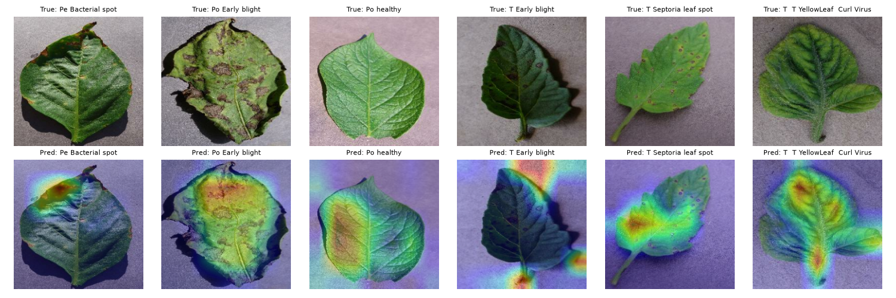
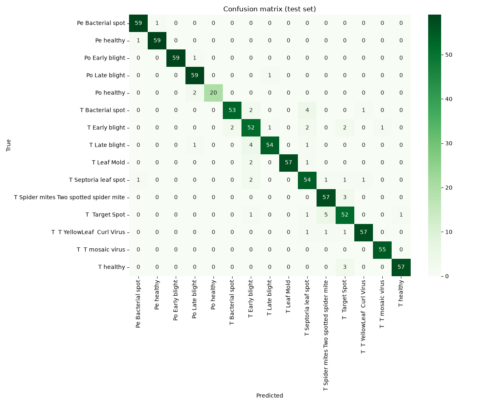

# Plant Disease Classification

A Keras image classifier that identifies 15 classes of pepper, potato and tomato leaf disease (including healthy leaves) from the PlantVillage dataset. I reused the transfer learning setup from my Cancer Detection project, a frozen MobileNetV3Large with a small dense head, and this time kept a separate test set and added Grad-CAM to see what the model looks at.



## How it works
1. The dataset is downloaded from Kaggle with `kagglehub` (`emmarex/plantdisease`, 20,637 images across 15 classes). The download contains a duplicate nested `PlantVillage` folder, which the notebook skips.
2. To keep training time down on a laptop CPU I take a random sample of up to 400 images per class (seed 42). Potato healthy only has 152 images and tomato mosaic virus has 373, so those classes are smaller.
3. 15% of each class is copied into `data/test` and never used in training. The rest goes into `data/train_val`, which `image_dataset_from_directory` splits 82/18 into training and validation with seed 123. That gives 3,992 training, 876 validation and 857 test images, roughly 70/15/15.
4. Images are resized to 224x224. MobileNetV3Large (ImageNet weights, frozen) is followed by GlobalAveragePooling2D, Dense layers of 1024, 512 and 128 units with ReLU, and a 15-way softmax. Only the head trains (1,576,463 parameters).
5. The model is trained for 8 epochs with Adam (learning rate 0.0001), categorical cross-entropy and batch size 16.
6. On the test set I report accuracy, a scikit-learn classification report and a confusion matrix.
7. Grad-CAM uses the `conv_1_bn` layer, the same layer I used for the cancer models, and overlays the heatmap on the leaf with the jet colour map.

## Results
All numbers are from the held-out test set of 857 images unless stated otherwise.

| Metric | Value |
|---|---|
| Test accuracy | 0.938 |
| Test loss | 0.190 |
| Macro F1 | 0.939 |
| Final validation accuracy (epoch 8) | 0.950 |
| Final training accuracy (epoch 8) | 0.997 |

The pepper and potato classes were the easiest, with F1 scores between 0.952 and 0.992. Most mistakes were between tomato diseases that produce similar spots: tomato early blight had the lowest F1 (0.846), followed by target spot (0.852) and Septoria leaf spot (0.871). Five target spot leaves were predicted as spider mite damage.



In the Grad-CAM examples the heatmap usually sits on the diseased patches of the leaf. For the tomato early blight example it focused on the background and the stem instead, even though the prediction was correct.

## Repository layout
| Path | What it is |
|---|---|
| `plant_disease.ipynb` | Data loading, subsampling, training, evaluation and Grad-CAM |
| `models/plant_disease_model.keras` | The trained model (32 MB) |
| `confusion_matrix.png` | Test set confusion matrix |
| `grad_cam_examples.png` | Grad-CAM heatmaps for six test images |
| `requirements.txt` | Python packages used |

## Running it
```
pip install -r requirements.txt
jupyter notebook plant_disease.ipynb
```
The notebook downloads the dataset with `kagglehub` and writes the subsample into `data/`, which is gitignored. Training took 8.3 minutes on an Apple M1 CPU and the whole notebook ran in about 9 minutes.

## Limitations
- The model is trained on roughly a quarter of the dataset because of the subsample, so the numbers could change with all 20,637 images.
- PlantVillage photos are single leaves on a plain background taken in a lab, so the model is unlikely to work as well on photos taken in a field.
- Training accuracy (0.997) is well above validation accuracy (0.950), so the head is starting to overfit by epoch 8.
- The classes are not balanced: potato healthy has only 22 test images.

This was written by AI for learning practice.
